# Hi, I'm Felix Helleckes 👋

**Senior QA Automation Engineer · Indie App Developer · WoW Addon Author** 
Cologne, Germany

I'm a Quality Assurance expert with over 8 years of experience building robust automation frameworks and keeping business-critical software reliable. In my spare time I ship apps and World of Warcraft addons — built end to end, from the code to the store listing.

### 🚀 Technical expertise
- **Languages:** JavaScript, TypeScript, Java, Python, Kotlin, Lua, Dart
- **Testing:** Playwright, WebdriverIO, Locust, Speedcurve, SAP testing, Postman, Jira/Xray, TestRail, Micro Focus UFT, BrowserStack
- **CI/CD & DevOps:** Jenkins, GitHub Actions, Docker, Kubernetes
- **Focus 2026:** AI-integrated test automation, cloud-native QA architectures, performance testing
- **Platforms:** Linux, Windows, macOS, Android, iOS

 

---

### 📱 Apps I built & shipped

| App | What it is | Stack |
|---|---|---|
| **[Moto-Log](https://motologbuch.netlify.app/)** | 100% offline service logbook for motorcycles — maintenance entries, service intervals and running costs. No account, no trackers. iOS & Android, five languages. | Flutter |
| **[EU Compliance Suite](https://eu-compliance-suite.fly.dev/)** | Shopify app for three EU consumer-law obligations taking effect in 2026: withdrawal button (Art. 11a CRD), legal-guarantee notice and the GARAN label (Reg. (EU) 2025/1960) — 24 languages, no theme code. | React Router 7, Prisma, Polaris, GraphQL Admin API |
| **[Mega Man: Advanced PET](https://mega-man-advanced-pet.vercel.app/)** | Fan-made mobile game: real-time 3×6 grid NetBattles, 200+ battle chips with fusion, co-op boss raids and a pedometer that charges battle fuel while you walk. | Flutter, Supabase |
| **[Dash & Slash](https://dash-and-slash.pages.dev/)** | One-handed action roguelite: drag and release to catapult-dash through enemies, tap to parry. Three zones, three bosses with three phases each, 28 relics and 8 synergies. Graphics and sound are generated in code. | Flutter, Flame |
| **[Clickwheel](https://clickwheel-app.pages.dev/)** | Offline music player with a real click wheel that rotates by angle and clicks audibly. No streaming, no ads, no connection. | Flutter |
| **[World Clock Live](https://worldclocklive.pages.dev/)** | LED world clock as a live desktop wallpaper for Windows and macOS — 24 cities, 7-segment digits, automatic DST, near-zero CPU usage. | Electron |
| **[Retrogram](https://icq-retrogram.pages.dev/)** | WhatsApp and Telegram in one retro ICQ 5 desktop app — a separate chat window per contact, the classic uh-oh sound, three skins. Free and open source. | Electron |

---

### 🎮 World of Warcraft addons by Felix Helleckes

Free on [CurseForge](https://www.curseforge.com/members/felix_helleckes/projects) · translated into all 11 WoW client languages · no libraries, combat-safe.

| Addon | What it does | Game |
|---|---|---|
| **[Campfire by Felix](https://www.curseforge.com/wow/addons/campfire-by-felix)** | Opens at every campfire: what your professions can place, reagents, blueprint drops, buff conflicts, one-click placing and a group camp plan | Forever |
| **[Weekly by Felix](https://www.curseforge.com/wow/addons/weekly-by-felix)** | Raid lockouts, weekly quests, gold and rested XP for all your alts in one table | Forever |
| **[Ready Room by Felix](https://www.curseforge.com/wow/addons/ready-room-by-felix)** | Raid prep checklist, leader readiness board, role and raid-mark assignments, Onyxia tactics | Forever |
| **[Tagline by Felix](https://www.curseforge.com/wow/addons/tagline-by-felix)** | A first-come queue for contested quest mobs with one-click group invites | Forever |
| **[Field of Honor by Felix](https://www.curseforge.com/wow/addons/field-of-honor-by-felix)** | Honor, Rank Points and weekly cap, Season Journey with Legacy Points, battleground stats | Forever |
| **[Greenhouse by Felix](https://www.curseforge.com/wow/addons/greenhouse-by-felix)** | Herb seeds on all characters, grow timers and crowd-sourced Seed Hybridizer ratios | Forever |
| **[HotsNDots by Felix](https://www.curseforge.com/wow/addons/hotsndots)** | Only your own HoTs and DoTs on nameplates, timer bars and a row for buffs and debuffs on yourself | Retail · Forever |
| **[Quest Tracker Hider by Felix](https://www.curseforge.com/wow/addons/quest-tracker-hider)** | Hides the Blizzard quest / objective tracker for a clean screen | Retail · Forever |
| **[BagBarHider by Felix](https://www.curseforge.com/wow/addons/bagbarhider)** | Hides the bag bar next to the micro menu | Retail · Forever |
| **[VolumeBar by Felix](https://www.curseforge.com/wow/addons/volumebar)** | A movable volume bar with one-click mute and mouse wheel | Retail · Forever |
| **[Warbander by Felix](https://www.curseforge.com/wow/addons/warbander)** | Warband dashboard: Great Vault, keystones, gold and currencies of all characters | Retail |

---

<!-- oss:start -->
### 🔧 Open-source contributions (AI-assisted with Claude Code)

**39 merged pull requests** in repositories I don't own 
+ 37 more in review · 7 issues reported

| Repository | Merged | In review |
|---|---:|---:|
| [storytold/filmcraft](https://github.com/storytold/filmcraft) | 37 | 33 |
| [storytold/craft-launcher](https://github.com/storytold/craft-launcher) | 2 | 4 |

**Latest merged**

- [Add a hex field to colour parameters in Effect Controls](https://github.com/storytold/filmcraft/pull/2359) — storytold/filmcraft, 2026-11-18
- [#2553: fall back to the integrated GPU when the chosen one can't draw to the window](https://github.com/storytold/filmcraft/pull/2558) — storytold/filmcraft, 2026-11-10
- [#1878: list fonts activated through Adobe Fonts](https://github.com/storytold/filmcraft/pull/2389) — storytold/filmcraft, 2026-10-31
- [#2375: the NVENC SDR sample entry test expects the BT.709 colr since #2142](https://github.com/storytold/filmcraft/pull/2386) — storytold/filmcraft, 2026-10-31
- [#2749: Export starts on Source In/Out when the sequence has In/Out marks](https://github.com/storytold/filmcraft/pull/2768) — storytold/filmcraft, 2026-10-31

Counted daily from the GitHub search API by a GitHub Action · last change 2026-11-25
<!-- oss:end -->

---

### 💼 Professional journey

<b>Senior Quality Assurance Engineer · E-Commerce (Bike24)</b> — 2023 – 2025

- High-performance QA strategies for a large-scale retail platform in SAP and the web frontend (Playwright).

<b>QA Manager & Automation Lead · Fashion Digital GmbH</b> — 2021 – 2023

- **WebdriverIO:** architected modern E2E test suites for enterprise-level web systems.
- **Performance testing:** Locust (Python) for stress-testing web architectures.
- **Infrastructure:** managed and configured QA environments in Kubernetes clusters.

<b>Test Automation Specialist · ampada GmbH</b> — 2021

- E2E automation with JavaScript/Gherkin and legacy desktop automation (VisualBasic/UFT).

<b>QA Engineer · grandcentrix GmbH</b> — 2018 – 2021

- IoT and app development; mobile automation frameworks with Appium and API testing with Postman.

<b>Independent QA Consultant · Gaming industry</b> — 2015 – 2018

- Manual and specialized testing for global leaders in the gaming industry (e.g. Blizzard Entertainment).

### 🧠 My QA philosophy
I bridge the gap between development and business requirements. With shift-left strategies and automated quality gates, stability becomes a feature, not an afterthought.

### 📫 Let's connect
- **Portfolio:** [felix-helleckes.github.io](https://felix-helleckes.github.io/)
- **LinkedIn:** [linkedin.com/in/felix-helleckes](https://www.linkedin.com/in/felix-helleckes/) · **Xing:** [Felix_Helleckes](https://www.xing.com/profile/Felix_Helleckes)
- **Stack Overflow:** [users/15774380](https://stackoverflow.com/users/15774380/felix-helleckes)
- **Tech blogs:** [dev.to/felix-helleckes](https://dev.to/felix-helleckes) · [felix-helleckes.medium.com](https://felix-helleckes.medium.com/)
- **Apps:** [App Store](https://apps.apple.com/de/developer/felix-helleckes/id6786716900) · [Google Play](https://play.google.com/store/apps/developer?id=Felix+Helleckes)
- **WoW addons:** [CurseForge](https://www.curseforge.com/members/felix_helleckes/projects)
- **Mail:** f.helleckes@proton.me
